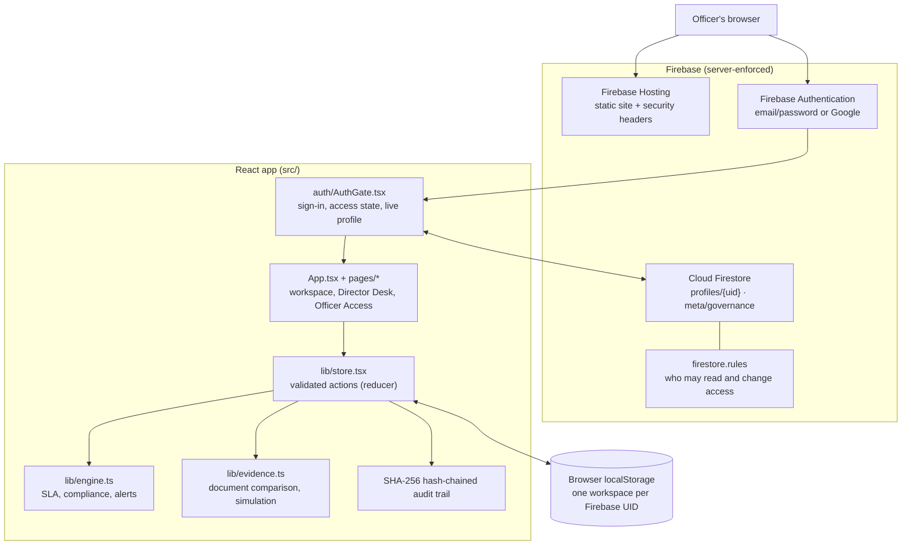
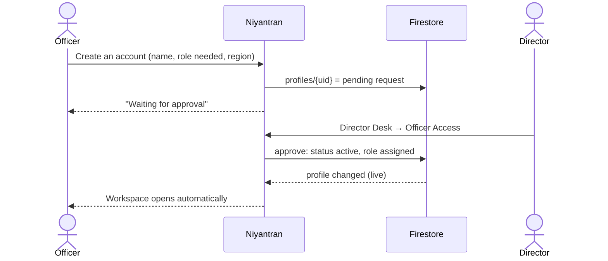
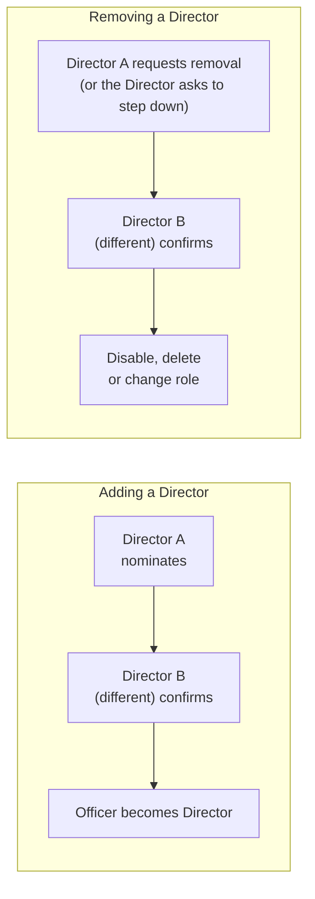
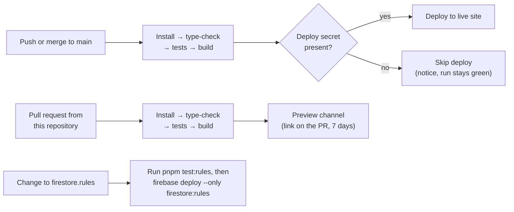

# Niyantran

**Regulatory command desk for AICTE approval workflows.** One workspace for application scrutiny, document evidence review, compliance monitoring, officer tasks, alerts, the APH rulebook, statutory decisions and a tamper-evident audit trail.

Live: **https://niyantran-4fee0.web.app**

> Niyantran is a working prototype. It is not an official AICTE service. The demo data and the `DEMO-DOC-1` clause are fictional and must never be cited as AICTE regulation.

---

## Contents

1. [Architecture](#architecture)
2. [Project structure](#project-structure)
3. [Officer access and roles](#officer-access-and-roles)
4. [Two-person rule for Directors](#two-person-rule-for-directors)
5. [Evidence Intelligence Engine](#evidence-intelligence-engine)
6. [Workflow and audit trail](#workflow-and-audit-trail)
7. [Security](#security)
8. [Run locally](#run-locally)
9. [Testing](#testing)
10. [CI/CD and deployment](#cicd-and-deployment)
11. [First-time Firebase setup](#first-time-firebase-setup)
12. [Limitations](#limitations)

---

## Architecture

Niyantran is a single-page React app served by Firebase Hosting.

- **Identity and officer access are server-enforced.** Firebase Authentication proves who someone is. Firestore security rules decide what they may read and change.
- **Case data is held in the browser**, one workspace per signed-in account. Every change goes through a validating reducer and is written to a SHA-256 hash-chained audit trail.



| Layer | Technology |
|---|---|
| UI | React 19, TypeScript, Vite 8, Tailwind CSS 4, Radix UI, lucide-react, Recharts |
| Identity | Firebase Authentication (email/password, Google) |
| Access control | Cloud Firestore + `firestore.rules` |
| Case data | Browser `localStorage`, scoped per Firebase UID |
| Integrity | SHA-256 hash chain (`src/lib/sha256.ts`, `verifyChain` in `store.tsx`) |
| Hosting | Firebase Hosting with strict security headers |
| CI/CD | GitHub Actions: check, build and deploy on `main`; preview builds for pull requests |
| Tests | Vitest; `@firebase/rules-unit-testing` with the Firestore emulator |

---

## Project structure

```
src/
  main.tsx                 Entry point: theme provider + AuthGate
  App.tsx                  Shell: sidebar, header, page routing (Director section only for Directors)
  auth/AuthGate.tsx        Waits for sign-in, reads profiles/{uid} live, picks the screen to show
  pages/
    Auth.tsx               Sign-in, sign-up with access request, pending / rejected / disabled screens
    DirectorDesk.tsx       Director dashboard: requests, officers by role, recent decisions
    Access.tsx             Officer Access: approve, edit, reset password, disable, delete, two-person panels
    Dashboard.tsx          Overview
    Tasks.tsx              "Aaj Ka Kaam": the signed-in officer's tasks
    Applications.tsx       Application register and case file
    Evidence.tsx           Evidence Intelligence workspace
    Evc.tsx                Expert Visit Committee management
    Compliance.tsx         Deposits, leases, undertakings, missing documents
    Rulebook.tsx           APH rule versions (draft → approval → published)
    Alerts.tsx             Alerts and escalations
    Institutions.tsx       Institution register
    Audit.tsx              Audit trail with chain verification
    Settings.tsx           Profile, notifications, backup, sign out and clear this browser
  lib/
    firebase.ts            Firebase app from VITE_FIREBASE_* variables
    profiles.ts            Officer profiles, access requests, Director nomination and removal
    useOfficerProfiles.ts  Live profile list and two-person-rule status for Directors
    store.tsx              State, validated actions, audit chain, persistence
    engine.ts              SLA clock, compliance checks, alerts, decision drafts
    evidence.ts            Field extraction, normalisation, comparison, findings, simulation
    types.ts               Domain types
    demo.ts                Fictional demo scenario (not loaded for signed-in users)
tests/rules/               Security-rules tests (Firestore emulator)
firestore.rules            Server-side access rules
firebase.json              Hosting config and security headers
.github/workflows/
  firebase-hosting-deploy.yml        Check, build and deploy on every push to main
  firebase-hosting-pull-request.yml  Preview deploy for pull requests from this repository
```

---

## Officer access and roles

Roles: **Director**, **Regional Officer**, **Scrutiny Officer**, **EVC Coordinator**, **Committee Member**.

Signing in proves *who* someone is. Their Firestore profile at `profiles/{uid}` decides *whether* they get in and *with which role*. Only a profile with `status: active` and a valid `role` opens the workspace. Everyone, Directors included, uses the same sign-in page; the role on the profile decides what they see.



| Profile status | What the person sees |
|---|---|
| *(no profile)* | Request-access form |
| `pending` | Waiting for approval |
| `rejected` | The reason, and the option to correct and resend |
| `disabled` | Access disabled |
| `active` with a valid role | The workspace (Directors land on the Director Desk) |

**Directors** manage everyone on **Officer Access**: approve or reject requests, edit details (not email, which is tied to the login), send password resets, disable, reactivate, delete, and add someone by account ID. The sidebar badge counts waiting requests and Director nominations needing your confirmation.

Applicants can only file and revise their **own** request. They can never set their own role or status.

---

## Two-person rule for Directors

No single person can grant or remove Director access. `firestore.rules` enforces this on the server; the screens only guide you through it.



**Bootstrap exception:** while there is only one Director, that Director may appoint *one* more Director alone. That appointment writes `meta/governance.twoPerson = true` in the same transaction, and the rule can never be switched off afterwards. A workspace that already has two or more Directors can switch it on from Officer Access.

Safeguards also enforced by the rules:
- A nomination or removal request is used once. It can't be reused after the profile's next Director decision, refreshed, or made in someone else's name.
- Nobody can confirm their own nomination or removal request.
- A Director can never remove their own Director access directly or delete their own profile.
- No one can be added straight in as a Director by account ID.

> With exactly two Directors, neither can remove the other unless that Director requests to step down. Keep at least three Directors if you need removals to work normally.

---

## Evidence Intelligence Engine

Decision support for cross-document consistency. It never approves, rejects or verifies anything by itself.

| Stage | Where | What happens |
|---|---|---|
| **Detect** | `evidence.ts` → `extractFields`, `compareRow` | Reads "Label: value" lines from text documents (.txt/.md), with page and line. PDFs and images are fingerprinted (SHA-256) and marked **unreadable**: an officer transcribes their fields, and nothing is guessed. Values are normalised (case, spacing, punctuation, abbreviations, dates) and compared as `MATCH`, `MISMATCH`, `NEEDS_REVIEW`, `NOT_FOUND` or `NOT_EVALUATED`. Numbers must agree exactly. |
| **Explain** | `evaluateEvidence`, `explainFinding` | Each field becomes a finding: `PASS`, `FAIL`, `NEEDS_REVIEW`, `NOT_EVALUATED` or `NOT_APPLICABLE`. `FAIL` is used only when the application's pinned APH version is **published** and has a clause in the `Documents` category. Otherwise the finding says "Regulatory reference requires verification". Explanations are deterministic; no AI is involved. |
| **Simulate** | `applyChanges`, `diffFindings`, `SIM_*` actions | "Approval crash-test": hypothetical values are applied to a copy of the evidence and stored separately in `state.simulations`, never on the application or in the audit trail. Shows what would be resolved, remain, be introduced or regress. Stale scenarios must be rebased. |
| **Verify** | `EV_FIELD_VERIFY`, `EV_FIELD_SET`, `EV_FINDING_REVIEW` | Only the officer assigned to the stage, or a Director or Regional Officer, may act, and never one affiliated with the institution. An officer can't verify their own transcription. Unconfirmed `FAIL`/`NEEDS_REVIEW` findings block the application from leaving Scrutiny. |
| **Record** | `appendAudit` | Each review is logged with the finding, outcome, reason, document versions and SHA-256, rule clause and a correlation ID, all included in the hash. |

Which fields are compared, and for which application type, is workflow configuration in `EVIDENCE_FIELDS`, not regulation.

---

## Workflow and audit trail

Applications move through **Scrutiny → EVC → Committee → Decision**. Each stage is routed to an officer with the matching role in the institution's region.

- **Fair SLA clock:** time waiting on the institution (open deficiency notices) is tracked separately and not counted against AICTE.
- **Rule versions:** each application is pinned to the APH version in force when it was received. A new version must be approved by a *different* Director or Regional Officer before it is published.
- **Decisions:** Niyantran drafts a decision from the case record. Only a Director or Regional Officer can sign it.
- **Audit trail:** every action is appended with before and after state, actor, time and rule version. Each event's SHA-256 hash includes the previous event's hash, so editing, deleting or reordering any event breaks **Verify integrity** on the Audit Trail page. The chain *detects* tampering; it does not prevent it.

---

## Security

### Controls

| Control | Where |
|---|---|
| Who can read and change officer access | `firestore.rules`, enforced by Firestore |
| Two-person rule for adding and removing Directors | `firestore.rules`, `meta/governance` |
| Officers see only their own profile; Directors see all; everything else is denied | `firestore.rules` |
| No email allow-list or self-activation: Director access only through the two-person rule | `firestore.rules`, `lib/profiles.ts` |
| Content-Security-Policy, `X-Frame-Options: DENY`, `nosniff`, `Referrer-Policy`, `Permissions-Policy` on every path | `firebase.json` |
| HTTPS only (HSTS) | Firebase Hosting |
| Minimum 8-character password on sign-up | `pages/Auth.tsx` |
| Conflict of interest: affiliated officers can't review that institution's evidence or sit on its EVC panel | `store.tsx` |
| "Sign out and clear this browser" for shared computers | Settings |
| Dev server bound to `localhost` | `vite.config.ts` |
| Patched dependency: `@grpc/grpc-js` ≥ 1.13.6 | `pnpm-workspace.yaml` |
| Preview workflow builds and checks every pull request, and never runs for forks, so they can't reach secrets | `firebase-hosting-pull-request.yml` |

### Latest security check

| Check | Result |
|---|---|
| Secrets, keys or `.env` files in the repository or its history | None |
| Personal emails, account IDs or phone numbers in the code or live site | None |
| Unsafe code (`innerHTML`, `eval`, `javascript:` links) | None |
| Known dependency vulnerabilities (`pnpm audit`) | None |
| Database access without signing in (profiles, governance, other paths) | Refused (HTTP 403) |
| Security headers on the live site | All present |
| Security-rules tests (`pnpm test:rules`) | 26 / 26 pass |
| Unit and page tests (`pnpm test`) | 42 / 42 pass |

No credentials are stored in the repository. The `VITE_FIREBASE_*` values are the public web configuration; access is controlled by the rules, not by hiding them. **Never commit a service-account key.**

**Recommended account settings:**
- **Firebase and Google Cloud Console:** enable App Check, turn on email-enumeration protection, restrict the API key to your domain, and limit authorized domains to the live site.
- **GitHub:** keep commit emails private (Settings → Emails).
- **Every Director:** turn on 2-Step Verification for your Google account.

---

## Run locally

Requirements: **Node.js 22+**, **pnpm**. Rules tests also need **Java** and the **Firebase CLI**.

```bash
cp .env.example .env.local      # fill in your Firebase web app config
pnpm install
pnpm dev                        # http://localhost:8443
```

| Script | Purpose |
|---|---|
| `pnpm dev` | Development server |
| `pnpm build` | Production build into `dist/` |
| `pnpm preview` | Serve the production build |
| `pnpm typecheck` | TypeScript check |
| `pnpm test` | Unit and page tests |
| `pnpm test:rules` | Security-rules tests in the Firestore emulator |

---

## Testing

- **`pnpm test`** (Vitest): document comparison, normalisation, findings and rule linking, simulation isolation, evidence permissions, the audit chain, profile and access logic, the two-person steps, and page rendering.
- **`pnpm test:rules`**: runs the real `firestore.rules` in a local emulator under the `demo-niyantran` project, which never touches production. It covers self-service limits, Director nomination, confirmation and removal, reuse of old requests, the governance lock, and email and self-protection rules. The emulator may open a console window on Windows while it runs.

GitHub Actions runs `typecheck` and `test` before every deploy.

---

## CI/CD and deployment



**Website (automatic):** `firebase-hosting-deploy.yml` runs on every push to `main`. It needs, in **GitHub → Settings → Secrets and variables → Actions**:
- **The Firebase web config,** as variables *or* secrets (the workflow reads either): `VITE_FIREBASE_API_KEY`, `VITE_FIREBASE_AUTH_DOMAIN`, `VITE_FIREBASE_PROJECT_ID`, `VITE_FIREBASE_STORAGE_BUCKET`, `VITE_FIREBASE_MESSAGING_SENDER_ID`, `VITE_FIREBASE_APP_ID`, `VITE_FIREBASE_MEASUREMENT_ID`. Without them the site builds but shows "Firebase is not configured".
- **The deploy secret** `FIREBASE_SERVICE_ACCOUNT_NIYANTRAN_4FEE0`. Create it with `firebase init hosting:github` (answer **No** to overwriting `firebase.json` or the workflows). Without it, the run still checks and builds, then skips publishing.

**Pull-request previews:** `firebase-hosting-pull-request.yml` runs the same install, type-check, tests and build for every pull request opened from this repository, then deploys it to a temporary preview channel. The preview link is posted on the pull request and expires after 7 days. Pull requests from forks are skipped, so they never reach your secrets. Previews never touch the live site.

**Manual deploy (fallback):**

```bash
pnpm build
firebase deploy --only hosting
```

**Security rules are never deployed by CI.** After changing `firestore.rules`:

```bash
pnpm test:rules
firebase deploy --only firestore:rules
```

Deploy rules and website together whenever both change, so the screens and the server rules always agree.

---

## First-time Firebase setup

For a **new** Firebase project (the live project is already set up):

1. Enable **Authentication** with the **Email/Password** and **Google** providers, and add your site under **Authorized domains**.
2. Create a **Cloud Firestore** database (the location can't be changed later), then run `firebase deploy --only firestore:rules`.
3. **Create the first Director, once, in Firebase Console:**
   1. Sign in to the app so the account exists, and note the **account ID** shown on screen.
   2. In Firestore, create `profiles/{that account ID}` with string fields `name`, `email` (exactly the sign-in email), `region`, `role: "Director"` and `status: "active"`.

   From then on, every other officer and Director is approved inside the app.
4. Add the GitHub variables and deploy secret described in [CI/CD and deployment](#cicd-and-deployment).

---

## Limitations

- **Case data is per browser.** Applications, evidence, decisions and the audit trail live in the signed-in user's browser storage. They are not shared between officers or devices, and anyone with access to that browser can edit them; the hash chain only detects this. Moving case data to Firestore with server rules is the next step before any real use.
- **Removing someone's profile doesn't delete their Firebase login.** It only removes their Niyantran access. Fully disabling the login needs a server (Cloud Functions).
- **No OCR.** Scanned PDFs and images need manual transcription. Original files are kept in memory only for the session; the stored SHA-256 fingerprint ties each file to the record.
- **Simulations cover document consistency only.** SLA, deposit, lease and undertaking checks are not simulated.
