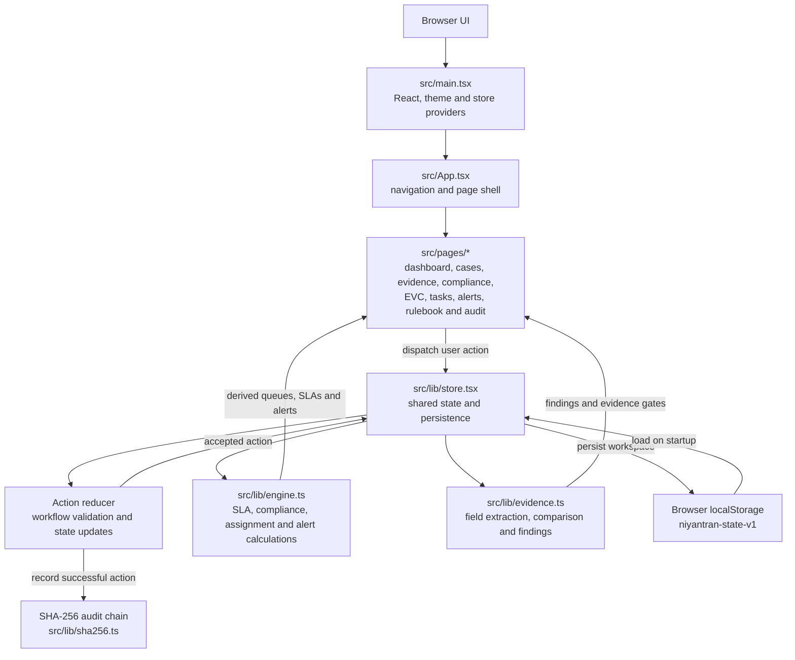

# Niyantran

Niyantran is a browser-based prototype of a regulatory command desk for AICTE approval workflows. It brings application processing, institution compliance, evidence review, officer tasks, alerts, rulebook management, decisions and audit history into one workspace.

The project is built with Vite, React 19 and TypeScript. It has no backend: workspace data is saved in the current browser's `localStorage`. Workflow actions are validated centrally by the store reducer, while SLA, compliance and alert information is derived from the current workspace and rulebook. Every recorded action is added to a SHA-256 hash-chained audit trail.

## Run locally

Requirements: Node.js and pnpm.

```
pnpm install
pnpm dev         # http://localhost:8443
pnpm test        # Vitest
pnpm typecheck
pnpm build
```

The first visit opens the setup screen, where you can create an officer profile. To explore the workflow without entering real data, select **Load synthetic demo**. Demo records are fictional and the included demo rulebook is explicitly labelled as non-regulatory.

## Architecture



### Main parts

- **Application shell — `src/App.tsx`:** Provides navigation, global search, setup, page selection and the shared workspace layout.
- **Pages — `src/pages/`:** Present the dashboard, application register and stage queues, Evidence Intelligence, EVC management, compliance monitor, rulebook, tasks, alerts, institutions, settings and audit trail.
- **State and workflow — `src/lib/store.tsx`:** Holds the typed workspace state and applies user actions through a central reducer. It checks permissions and workflow preconditions, then records successful changes. A rejected workflow action does not partially update state.
- **Rules and derived views — `src/lib/engine.ts`:** Calculates information such as stage timing, SLA status, assignments, compliance status and alerts from applications, institutions and the applicable rule version.
- **Evidence review — `src/lib/evidence.ts`:** Extracts supported labelled text fields, compares values across documents, creates explainable findings and evaluates hypothetical simulation changes.
- **Persistence and audit — `src/lib/store.tsx` and `src/lib/sha256.ts`:** Save the workspace in browser storage and append actions to a hash-linked audit chain. The audit integrity check can detect changes to recorded events; it does not prevent someone from changing browser data.

## How the workflow works

1. **Set up a workspace.** Create an officer profile or load the fictional demo. The selected officer is a local prototype role, not an authenticated account.
2. **Configure institutions and rules.** Maintain institution records and draft, review and publish rule versions. Applications retain the rule version they were created against unless an authorized officer migrates them.
3. **Register and assign applications.** Create LoA or EoA cases, attach checklist documents and undertakings, and assign officers to workflow stages.
4. **Process the case.** Cases move through **Scrutiny → EVC → Committee → Decision**. Officers handle stage work, deficiencies and responses, site visits and reports, committee recommendations, and decision drafting. Authorized roles sign final outcomes.
5. **Monitor work and compliance.** The engine derives SLA clocks, due dates, compliance indicators, alerts and escalations from current case data and rule versions. The task and alert views provide officer work queues.
6. **Review and record evidence.** Evidence Intelligence compares supported fields between documents. Officers verify transcriptions against originals and record findings reviews; unresolved findings can block progression from Scrutiny.
7. **Inspect history or test scenarios.** Real actions are written to the audit trail. Evidence simulations show hypothetical changes separately and do not alter the official application or its audit history.

## Evidence Intelligence Engine

Decision support for cross-document consistency. It never approves, rejects or verifies anything on its own.

| Stage | Where | What happens |
|---|---|---|
| Detect | `src/lib/evidence.ts` `extractFields`, `compareRow` | "Label: value" lines are read from text documents (.txt/.md) with page and line. PDFs and images are fingerprinted (SHA-256) and marked **unreadable**: fields are transcribed by an officer, never guessed. Values are normalised (case, spacing, punctuation, abbreviations in `ALIASES`, dates) and compared: `MATCH`, `MISMATCH`, `NEEDS_REVIEW` (near matches, ambiguous or unreadable sources), `NOT_FOUND`, `NOT_EVALUATED`. Numbers must agree exactly. |
| Explain | `evaluateEvidence`, `explainFinding` | Each field becomes a finding: `PASS`, `FAIL`, `NEEDS_REVIEW`, `NOT_EVALUATED` or `NOT_APPLICABLE`. `FAIL` is used only when the application's pinned APH version is **published** and has a clause in the `Documents` category; otherwise the finding is `NEEDS_REVIEW` with "Regulatory reference requires verification". Explanations are built deterministically from the finding; no LLM is involved. |
| Simulate | `applyChanges`, `diffFindings`; `SIM_*` actions | Hypothetical values are applied to a deep copy of the evidence. Scenarios live in `state.simulations`, never on the application or in the audit chain. The finding diff shows what is resolved, remaining, newly introduced or regressed. Stale scenarios are detected via an evidence fingerprint and must be rebased. |
| Verify | `EV_FIELD_VERIFY`, `EV_FIELD_SET`, `EV_FINDING_REVIEW` | Only the officer assigned to the current stage, or a Director/Regional Officer, may act, and never one affiliated with the institution. An officer cannot verify their own transcription. "Confirm evidence" requires every value to be checked against its original first. "Request clarification" issues a deficiency notice (existing workflow; pauses the SLA clock). "Escalate" creates a task for the regional Regional Officer. A review is tied to the exact evidence it saw; new versions invalidate it. Unconfirmed `FAIL`/`NEEDS_REVIEW` findings block leaving Scrutiny. |
| Record | `appendAudit` meta | Audit events carry the finding ID, outcome, reason, evidence document versions and SHA-256, rule clause and a correlation ID. Metadata is part of the hashed body, so altering it breaks `verifyChain`. Hashing detects tampering; it does not prevent it. |

Field definitions, their source documents and per-application-type applicability are workflow configuration in `EVIDENCE_FIELDS`, not regulatory requirements.

### Demo (fictional data)

1. Start with an empty workspace (Settings → reset, or a new browser profile) and choose **Load synthetic demo** on the setup screen. You act as the Demo Scrutiny Officer.
2. Open **Evidence Intelligence** → the application. The consistency matrix shows the address read from three documents. The NOC says Sector 12, so the location finding is `FAIL` against the labelled demo clause `DEMO-DOC-1` (not an AICTE regulation).
3. **Approval crash-test** → Run simulation → set the NOC address to "Plot 4, Sector 10, Greater Noida, Uttar Pradesh 201310". The location finding shows as resolved, and the Scrutiny evidence gate goes from 1 to 0 in the simulation only. Go back to the findings: the official result is still `FAIL`.
4. **Findings & review** → Explain & review: check each value against its original, then record an action such as *Request clarification*. Switch the acting officer to the EVC Coordinator to see the permission-denied state.
5. Optionally upload `public/demo/demo-noc-corrected.txt` as a new version of the NOC. The simulation becomes stale, the earlier review no longer applies, and the finding is re-evaluated.
6. **Decision history** (or the Audit Trail page) shows each real action with evidence versions and the rule clause. Use **Verify chain integrity** to check the hash chain.

### Limitations

- There is no server. Workflow checks run in the client-side reducer, not on a trusted server. The officer switcher is not authentication, and someone with access to the browser can edit `localStorage`. The audit chain detects changes to audit events; it does not prevent edits to browser data.
- This is a prototype workflow system, not an official AICTE service or a replacement for statutory review by authorized officers. Demo rule clauses and records are fictional.
- No OCR. Scanned PDFs and images need manual transcription. Original files are kept only in memory for the session; the stored fingerprint lets an officer match a file to the record.
- Only document-consistency findings are simulated. SLA, deposit, lease and undertaking checks are not.
