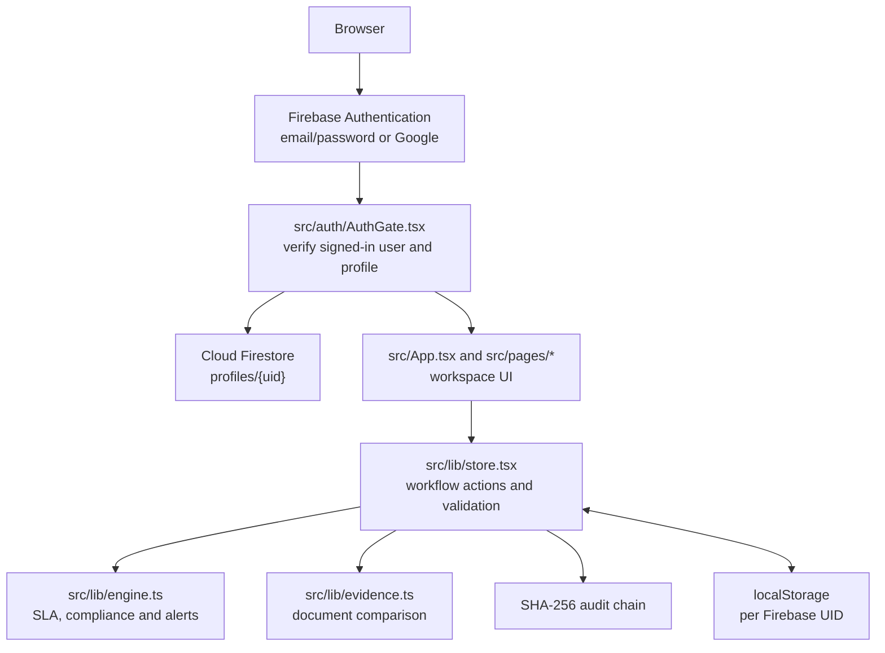

# Niyantran

<<<<<<< HEAD
Regulatory command desk prototype for AICTE approval workflows. Vite + React 19 + TypeScript. All data lives in the browser (`localStorage`); every rule is enforced in the action reducer in `src/lib/store.tsx`, and every action is written to a SHA-256 hash-chained audit trail.
=======
Niyantran is a browser-based prototype of a regulatory command desk for AICTE approval workflows. It brings application processing, institution compliance, evidence review, officer tasks, alerts, rulebook management, decisions and audit history into one workspace.

The project uses Vite, React 19 and TypeScript. Firebase Authentication gates access and a read-only Firestore profile assigns each person's officer role. Application/workflow data remains in browser `localStorage`, scoped to the signed-in Firebase account; it is not synchronized between users or devices. Workflow actions are checked by the client-side reducer, and recorded actions are written to a SHA-256 hash-chained audit trail.

## Architecture



### Run locally

Requirements: Node.js and pnpm. Copy `.env.example` to `.env.local` and fill it with the Firebase web app configuration, then:
>>>>>>> fbef2ec78d35b12985047eddeb6881c7c25b1483

```
pnpm install
pnpm dev         # http://localhost:8443
pnpm test        # Vitest
pnpm typecheck
pnpm build
```

<<<<<<< HEAD
=======
## Firebase authentication and account setup

1. In Firebase Console, enable **Email/Password** and **Google** under Authentication → Sign-in method. Add the deployed Hosting domain under Authentication → Settings → Authorized domains if it is not already present.
2. Users can select **Create an account** on the sign-in screen to register with email/password, or sign in with Google. New Firebase Auth accounts do not grant application access by themselves.
3. For each person, create a Firestore document at `profiles/{Firebase Auth UID}` with string fields `name`, `email`, `phone`, `jobTitle`, `region`, and `institutionAffiliation`, plus `role` and `status`. Use an existing officer role (`Director`, `Regional Officer`, `Scrutiny Officer`, `EVC Coordinator`, or `Committee Member`) and set `status` to `active`. Profiles without an active recognized role are denied access.
4. Client access to profile documents is read-only. Assign or change roles through Firebase Console/Admin SDK only; do not make role assignment available to end users.

The Cloud Firestore API and a Firestore database must be enabled/created in the Firebase project before profile lookup works. Choose the database location in Firebase Console; location cannot be changed after creation. Deploy the site and profile security rules with:

```
pnpm build
firebase deploy --only hosting,firestore:rules --project niyantran-4fee0
```

The Firebase web configuration is supplied through `.env.local` and is not an Admin SDK credential. Never put service-account keys in the frontend or commit them.

>>>>>>> fbef2ec78d35b12985047eddeb6881c7c25b1483
## Evidence Intelligence Engine

Decision support for cross-document consistency. It never approves, rejects or verifies anything on its own.

| Stage | Where | What happens |
|---|---|---|
| Detect | `src/lib/evidence.ts` `extractFields`, `compareRow` | "Label: value" lines are read from text documents (.txt/.md) with page and line. PDFs and images are fingerprinted (SHA-256) and marked **unreadable**: fields are transcribed by an officer, never guessed. Values are normalised (case, spacing, punctuation, abbreviations in `ALIASES`, dates) and compared: `MATCH`, `MISMATCH`, `NEEDS_REVIEW` (near matches, ambiguous or unreadable sources), `NOT_FOUND`, `NOT_EVALUATED`. Numbers must agree exactly. |
| Explain | `evaluateEvidence`, `explainFinding` | Each field becomes a finding: `PASS`, `FAIL`, `NEEDS_REVIEW`, `NOT_EVALUATED` or `NOT_APPLICABLE`. `FAIL` is used only when the application's pinned APH version is **published** and has a clause in the `Documents` category; otherwise the finding is `NEEDS_REVIEW` with "Regulatory reference requires verification". Explanations are built deterministically from the finding; no LLM is involved. |
| Simulate | `applyChanges`, `diffFindings`; `SIM_*` actions | Hypothetical values are applied to a deep copy of the evidence. Scenarios live in `state.simulations`, never on the application or in the audit chain. The finding diff shows what is resolved, remaining, newly introduced or regressed. Stale scenarios are detected via an evidence fingerprint and must be rebased. |
| Verify | `EV_FIELD_VERIFY`, `EV_FIELD_SET`, `EV_FINDING_REVIEW` | Only the officer assigned to the current stage, or a Director/Regional Officer, may act, and never one affiliated with the institution. An officer cannot verify their own transcription. "Confirm evidence" requires every value to be checked against its original first. "Request clarification" issues a deficiency notice (existing workflow; pauses the SLA clock). "Escalate" creates a task for the regional Regional Officer. A review is tied to the exact evidence it saw; new versions invalidate it. Unconfirmed `FAIL`/`NEEDS_REVIEW` findings block leaving Scrutiny. |
| Record | `appendAudit` meta | Audit events carry the finding ID, outcome, reason, evidence document versions and SHA-256, rule clause and a correlation ID. Metadata is part of the hashed body, so altering it breaks `verifyChain`. Hashing detects tampering; it does not prevent it. |

Field definitions, their source documents and per-application-type applicability are workflow configuration in `EVIDENCE_FIELDS`, not regulatory requirements.

### Demo (fictional data)

<<<<<<< HEAD
1. Start with an empty workspace (Settings → reset, or a new browser profile) and choose **Load synthetic demo** on the setup screen. You act as the Demo Scrutiny Officer.
2. Open **Evidence Intelligence** → the application. The consistency matrix shows the address read from three documents. The NOC says Sector 12, so the location finding is `FAIL` against the labelled demo clause `DEMO-DOC-1` (not an AICTE regulation).
3. **Approval crash-test** → Run simulation → set the NOC address to "Plot 4, Sector 10, Greater Noida, Uttar Pradesh 201310". The location finding shows as resolved, and the Scrutiny evidence gate goes from 1 to 0 in the simulation only. Go back to the findings: the official result is still `FAIL`.
4. **Findings & review** → Explain & review: check each value against its original, then record an action such as *Request clarification*. Switch the acting officer to the EVC Coordinator to see the permission-denied state.
5. Optionally upload `public/demo/demo-noc-corrected.txt` as a new version of the NOC. The simulation becomes stale, the earlier review no longer applies, and the finding is re-evaluated.
6. **Decision history** (or the Audit Trail page) shows each real action with evidence versions and the rule clause. Use **Verify chain integrity** to check the hash chain.

### Limitations

- There is no server. "Server-side" checks run in the reducer, but the officer switcher is not authentication, and someone with access to the browser can edit `localStorage`. The audit chain detects such edits; it does not prevent them.
=======
The synthetic scenario builder in `src/lib/demo.ts` contains fictional records and a labelled demo rulebook, not AICTE regulations. It is not automatically loaded into authenticated workspaces. Never use its data as a real application or regulatory reference.

### Limitations

- Firebase Authentication verifies identity, and Firestore controls access to the profile document. Workflow records still live only in browser storage, so users do not share cases across browsers/devices. Client-side workflow checks and the audit chain are not a trusted server boundary; someone with access to browser storage can alter local data. Do not use this prototype as a production statutory decision system.
>>>>>>> fbef2ec78d35b12985047eddeb6881c7c25b1483
- No OCR. Scanned PDFs and images need manual transcription. Original files are kept only in memory for the session; the stored fingerprint lets an officer match a file to the record.
- Only document-consistency findings are simulated. SLA, deposit, lease and undertaking checks are not.
